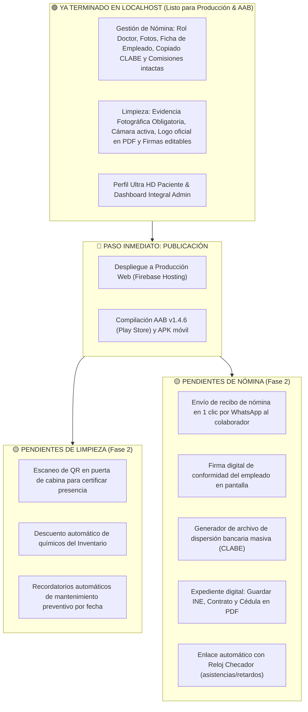

# 📌 Lista de Mejoras Pendientes — Clínica ALFRA
*Documento maestro de control: estado en Localhost, paquete para Producción/AAB y siguientes fases.*  
*Fecha de actualización: 29 de Octubre de 2026*

---

> [!IMPORTANT]
> **Aclaración clave de estado**:  
> Tanto lo de **Limpieza** como lo de **Gestión de Nómina** solicitados en las sesiones anteriores **YA ESTÁN COMPLETAMENTE PROGRAMADOS Y FUNCIONANDO EN LOCALHOST**.  
> Lo que está pendiente con ellos es **subirlos a Producción Web y compilarlos en el nuevo AAB para celulares**.  
> Además, aquí se desglosan las **mejoras a futuro (Fase 2)** para enriquecer aún más ambos módulos.

---

## 🧭 Mapa General: ¿Dónde está cada módulo?



---

## 🧹 1. MÓDULO DE LIMPIEZA & BITÁCORAS COFEPRIS

### ✅ Lo que YA ESTÁ HECHO en Localhost (Listo para salir a Producción y AAB)
* **Archivos clave**: [`LimpiezaDashboard.jsx`](file:///c:/Users/aleja/.gemini/antigravity/playground/app-alfra/src/pages/limpieza/LimpiezaDashboard.jsx) (`/limpieza`), [`AdminTareasLimpieza.jsx`](file:///c:/Users/aleja/.gemini/antigravity/playground/app-alfra/src/pages/admin/AdminTareasLimpieza.jsx) (`/admin-tareas-limpieza`), [`ModalConfigurarFirmasPDF.jsx`](file:///c:/Users/aleja/.gemini/antigravity/playground/app-alfra/src/components/limpieza/ModalConfigurarFirmasPDF.jsx) y [`limpiezaPdfService.js`](file:///c:/Users/aleja/.gemini/antigravity/playground/app-alfra/src/services/limpiezaPdfService.js).
1. **Evidencia Fotográfica 100% Obligatoria**:
   - No se permite cerrar ni dar por concluida ninguna cabina si no tiene al menos 1 fotografía de evidencia.
   - Si el operador intenta concluir sin foto, el sistema bloquea la acción, muestra la alerta `⚠️ Evidencia obligatoria` y activa directamente la cámara/selector del celular.
   - Tarjetas con indicadores claros: `⚠️ Falta Foto Obligatoria` $\rightarrow$ `✓ Aseo y Evidencia OK`.
2. **Logotipo Oficial ALFRA en Reportes PDF**:
   - Integrado en alta definición (`/logo.png`) en el encabezado de los 3 reportes: Bitácora Diaria, Concentrado Mensual COFEPRIS y Mantenimiento.
3. **Firmas y Datos Sanitarios Editables en Tiempo Real**:
   - Modal interactivo para cambiar Doctor(a), Responsable Sanitario, Cédulas, Folio de Aviso de Funcionamiento y Operador(a), con memoria de predeterminados.
4. **Administración Total de Cabinas y Tareas**:
   - El administrador puede agregar, renombrar o eliminar cabinas, áreas clínicas y tareas desde [`AdminConfiguracionEspacios.jsx`](file:///c:/Users/aleja/.gemini/antigravity/playground/app-alfra/src/components/limpieza/AdminConfiguracionEspacios.jsx).
5. **Tipografía y Acentos Corregidos**:
   - Auto-sanitizador activo; cero caracteres rotos ni signos `?` en reportes ni en pantalla.

### ⏳ Mejoras PENDIENTES para Limpieza (Siguiente Fase)
* [ ] **Descuento Automático de Inventario**: Al marcar completada una cabina, descontar automáticamente las dosis de Cuaternario de Amonio o Alcohol del módulo de Inventario ([`inventarioService.js`](file:///c:/Users/aleja/.gemini/antigravity/playground/app-alfra/src/services/inventarioService.js)).
* [ ] **Código QR Físico en Puerta de Cabina**: Pegar un sticker con QR en cada cabina; el personal debe escanearlo con la cámara del celular para confirmar que está físicamente parado en la cabina antes de registrar el aseo.
* [ ] **Alertas de Mantenimiento Preventivo Programadas**: Notificación automática cuando un equipo o cabina cumpla 30 días sin mantenimiento preventivo registrado.

---

## 💼 2. MÓDULO DE GESTIÓN DE PERSONAL & NÓMINA

### ✅ Lo que YA ESTÁ HECHO en Localhost (Listo para salir a Producción y AAB)
* **Archivos clave**: [`NominaView.jsx`](file:///c:/Users/aleja/.gemini/antigravity/playground/app-alfra/src/pages/admin/NominaView.jsx) (`/nomina`) y [`staffService.js`](file:///c:/Users/aleja/.gemini/antigravity/playground/app-alfra/src/services/staffService.js).
1. **Rol Formal de 'Doctor'**:
   - Opción integrada en alta y edición con badge estilizado `🩺 Doctor` y permisos clínicos plenos en el sistema.
2. **Fotografía de Perfil Personalizada**:
   - Carga y optimización de foto de cada colaborador, visible en la tabla general, modal de edición, expediente y recibo de nómina.
3. **Ficha / Credencial del Empleado**:
   - Modal detallado con foto en grande, WhatsApp, contacto de emergencia, cédula profesional, turno, fecha de ingreso, cálculo automático de antigüedad y datos bancarios.
   - **Botón de Copiar CLABE en 1 clic**: Para transferir sueldos sin teclear 18 dígitos manualmente.
4. **Esquema de Comisiones 100% Intacto**:
   - Se conservó exactamente la lógica original: % comisión de servicios, % comisión de productos, cálculo en tiempo real, bonos de puntualidad y productividad, ajustes y desglose.

### ⏳ Mejoras PENDIENTES para Nómina (Siguiente Fase)
* [ ] **Envío de Recibo por WhatsApp en 1 Clic**: Botón verde en cada fila para abrir WhatsApp y mandarle a cada empleado el resumen de su sueldo base + comisiones + bonos en texto y PDF.
* [ ] **Firma Digital de Recibos de Nómina**: Canvas en pantalla donde el empleado firma de recibido con su dedo o lápiz en la tablet/celular, generando un comprobante legal firmado.
* [ ] **Archivo de Dispersión Bancaria Masiva (Layout SPEI / BBVA / Santander)**: Botón para exportar un archivo de texto o Excel con las CLABES y montos calculados para pagar a todos los empleados desde la banca en línea de un solo clic.
* [ ] **Expediente de Documentación Digital**: Pestaña en la ficha del colaborador para adjuntar en PDF su Contrato Laboral, INE, Comprobante de Domicilio y Cédula Profesional.
* [ ] **Enlace Automático con el Reloj Checador**: Conectar las checadas biométricas/GPS para que si un colaborador tiene 0 retardos en la quincena, se le marque automáticamente el switch de "Bono de Puntualidad".

---

## 🚀 3. EL PENDIENTE INMEDIATO: DESPLIEGUE A PRODUCCIÓN Y AAB

Para que todo el trabajo anterior de **Limpieza** y **Nómina** esté funcionando en los celulares y computadoras de la clínica, el pendiente principal es **ejecutar el despliegue**:

1. **Producción Web**:
   ```bash
   npm run build
   firebase deploy --only hosting
   ```
2. **Compilación de App Móvil Android (AAB para Google Play Console y APK directo)**:
   - Incrementar versión en [`android/app/build.gradle`](file:///c:/Users/aleja/.gemini/antigravity/playground/app-alfra/android/app/build.gradle) a `versionCode 98` / `versionName "1.4.6"`.
   - Sincronizar: `npx cap sync android`.
   - Compilar paquete firmado: `./gradlew bundleRelease` (genera `app-release.aab`).
   - Compilar instalador directo: `./gradlew assembleRelease` (genera `app-release.apk`).

---

## ⏱️ 4. OTROS PENDIENTES GLOBALES DEL SISTEMA

1. **Reloj Checador Digital**: Activar geovalla GPS y persistencia en [`ChecadorView.jsx`](file:///c:/Users/aleja/.gemini/antigravity/playground/app-alfra/src/pages/ChecadorView.jsx).
2. **Notificaciones Push en Android (Android 13+)**: Solicitar permiso `POST_NOTIFICATIONS` y configurar canales para que suenen con la app cerrada.
3. **Audio Físico de Notificaciones en PC**: Colocar `notification.mp3` en la carpeta `public/` para que timbre la computadora en recepción ante alertas.
